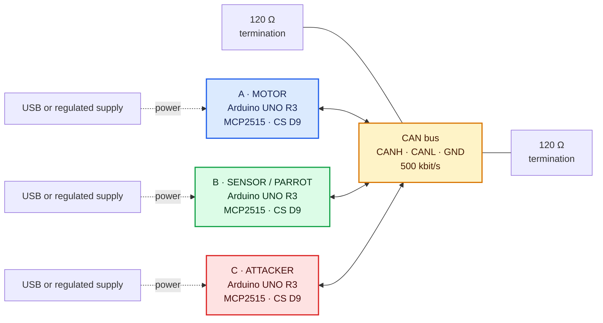
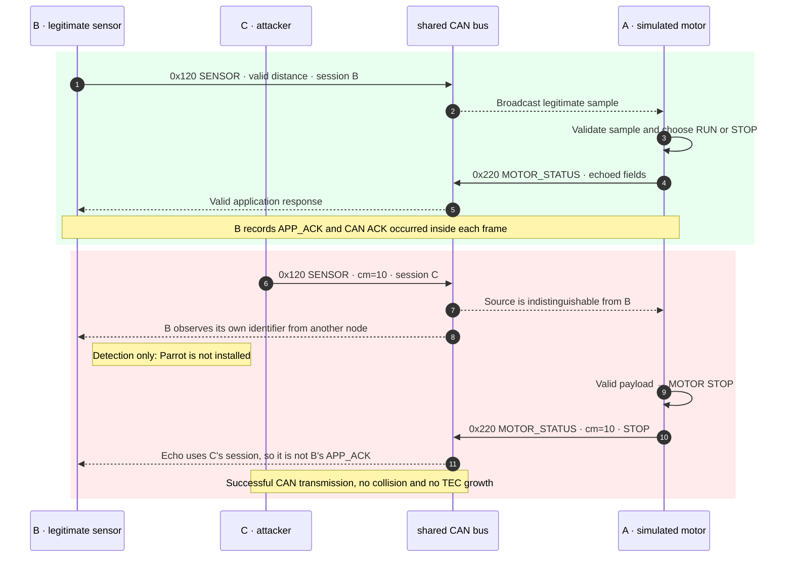
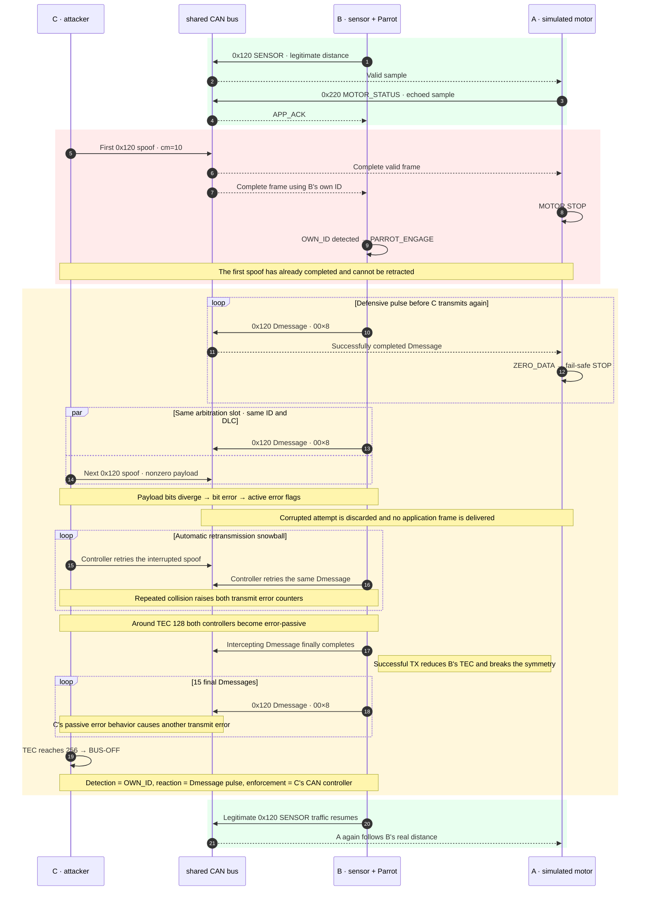
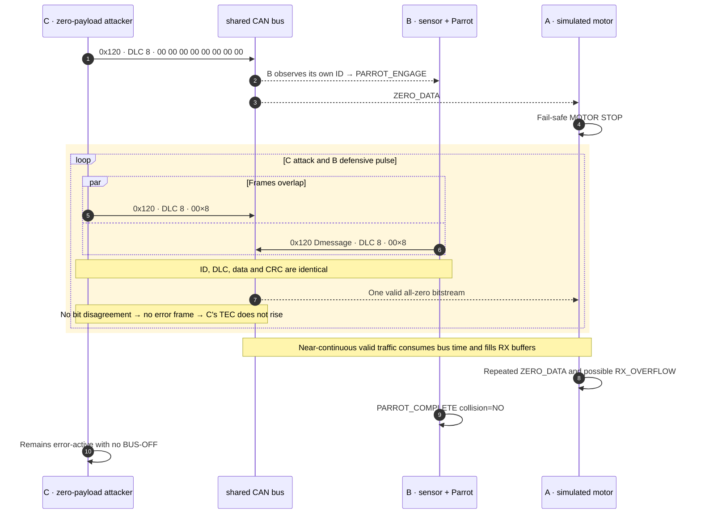
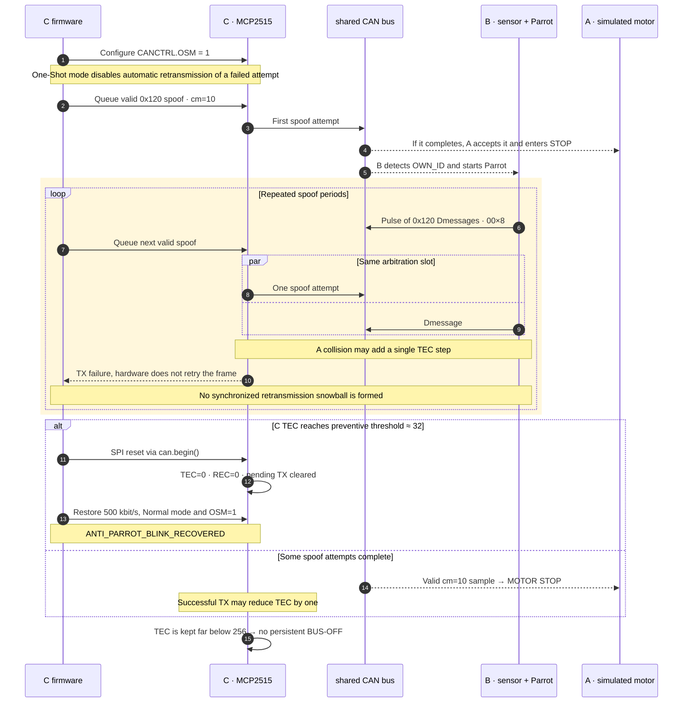
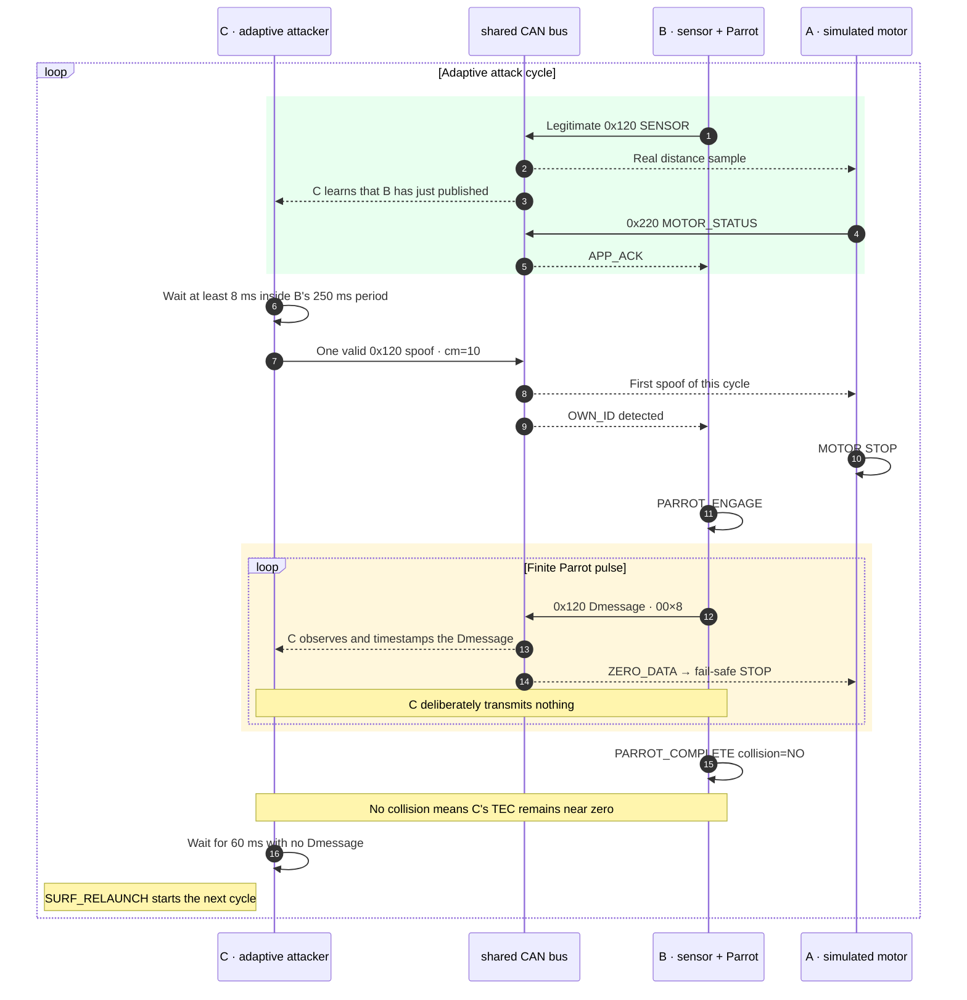

# Paper-Perishes-Parrot

Experimental project using three Arduino UNO boards and MCP2515 controllers to
study spoofing on Classical CAN and the Parrot defense proposed by Dagan and
Wool.

## Flat project structure

Every variant except `simple` uses the same flat structure:

```text
<variant>/
├── <variant>.ino   Arduino sketch entry point
├── NodeConfig.h    selects the node to compile
├── Protocol.h      shared application protocol
├── A.ino           simulated motor
├── B.ino           sensor and, when applicable, Parrot defense
└── C.ino           attacker for the selected variant
```

Each node implementation is isolated in its own `.ino` file. There is no
longer a shared `CanLabNode.h` containing the three behaviors, and there are no
duplicate copies of `Protocol.h` in node subdirectories.

## Selecting and uploading a node

Arduino compiles all `.ino` files in a sketch directory together. Therefore,
`NodeConfig.h` selects which file provides `setup()` and `loop()`:

```cpp
#define ACTIVE_NODE NODE_A  // NODE_A, NODE_B, or NODE_C
```

To program the three boards with a variant such as `attack`:

1. Open `attack/attack.ino` in Arduino IDE.
2. Set `ACTIVE_NODE` to `NODE_A` in `NodeConfig.h`, select A's serial port, and
   upload.
3. Set it to `NODE_B`, select B's port, rebuild, and upload.
4. Set it to `NODE_C`, select C's port, rebuild, and upload.
5. Open C's Serial Monitor at 115200 baud and send `a` to start or stop the
   periodic attack. Send `1` to transmit a single attack frame.

Do not open `A.ino`, `B.ino`, or `C.ino` as independent sketches. They are the
implementation units of the flat sketch. The file named after the directory,
such as `attack.ino`, is only the Arduino-required entry point; the attack
itself is implemented directly in `C.ino`.

## Physical topology and message legend

All scenarios use the same three-node bus. The arrows below represent a shared
broadcast medium, not point-to-point links: every valid CAN frame is visible to
all three MCP2515 controllers.



The bus uses Classical CAN, standard 11-bit identifiers, eight-byte data frames
and 16 MHz MCP2515 crystals. CANH, CANL and GND are shared. Each board may be
powered independently; do not join the 5 V rails of independent supplies.

| Visual role | CAN frame | Payload | Meaning |
|---|---|---|---|
| Legitimate | `B → 0x120 SENSOR` | `01 · seq · cm · fault · session_B` | Distance sample published every 250 ms |
| Application response | `A → 0x220 MOTOR_STATUS` | `01 · echoed seq · echoed cm · state · session` | `STOP`, `RUN`, or sensor-fault decision; also B's `APP_ACK` |
| Spoof | `C → 0x120 SENSOR` | Usually a valid sample with `cm=10` | C impersonates B; the identifier does not authenticate its source |
| Parrot defense | `B → 0x120 Dmessage` | `00 00 00 00 00 00 00 00` | Dominant-data frame intended to collide with C's next spoof |

`CAN ACK` is not another application frame. It is the dominant ACK-slot bit
generated by a receiving controller. `APP_ACK` is B's name for a valid
`MOTOR_STATUS` response from A.

### How to read the diagrams

Green regions show normal application traffic, red regions show accepted
spoofing traffic, and amber regions show Parrot or controller-level behavior.

| Layer | Question answered | Typical evidence |
|---|---|---|
| Application | What value did A accept and what did the simulated motor do? | `MOTOR RUN`, `MOTOR STOP`, `APP_ACK` |
| Detection | Did B observe another controller using its identifier? | `OWN_ID`, `PARROT_ENGAGE` |
| Defensive reaction | What traffic did B deliberately generate? | `PARROT_PULSE_START`, zero-filled Dmessages |
| CAN controller | Did a real collision change the controller error state? | `TEC`, `REC`, `EFLG`, error-passive, `BUS-OFF` |

A detection is not automatically a successful defense. Parrot only removes C
when its reaction produces the specific sequence of controller-level errors
needed to raise C's TEC to BUS-OFF.

## Scenarios

### `attack`: spoofing without a defense

This is the baseline scenario without Parrot. B publishes legitimate samples
using identifier `0x120`, while C uses the same identifier to transmit valid
SENSOR messages containing a false distance of 10 cm. Since CAN does not
authenticate the source of a frame, A cannot distinguish B from C and processes
the false sample, placing the simulated motor in STOP.

This scenario shows that knowing the identifier and payload format is enough to
impersonate B. C can use its own session value because A interprets a session
change as a possible sensor restart. Neither the CAN identifier nor the session
authenticates the sender.



### `deffense`: Parrot implemented in B

This variant implements Parrot exclusively in B. When B receives a frame with
its own identifier `0x120`, it treats it as a spoofing attempt and transmits a
continuous sequence of zero-filled Dmessages. Collisions and automatic
retransmissions increase C's Transmit Error Counter (TEC), eventually forcing C
into error-passive and then BUS-OFF.

Parrot cannot necessarily prevent the first spoofed message. B detects the
attack by receiving that same frame from the bus, but A may already have
received and processed it. The defense acts against subsequent attacker
transmissions and attempts to remove C from the bus; it cannot retract a frame
that has already completed successfully.



The Dmessages are real CAN data frames. When they complete without a collision,
the current A firmware records `ZERO_DATA` and enters its fail-safe STOP state.
When a Dmessage collides with C, the corrupted attempt is rejected by every
receiver and only the controllers' error-confinement logic acts on it.

### `attack-DoS-zeros`: zero-payload evasion

This variant implements the evasion described in Section 4.5.5 of Mert Dieter
Pesé's thesis,
[*Bringing Practical Security to Vehicles*](https://rtcl.eecs.umich.edu/rtclweb/assets/dissertations/2022/mpese_thesis_v3.pdf#page=151).
C transmits `0x120` with eight zero data bytes, exactly matching the Dmessage
used by B.

If B and C transmit the same bit sequence, there is no dominant/recessive
difference capable of generating a CAN error. The retransmission snowball does
not begin, so C's TEC does not grow toward BUS-OFF. These frames are not valid
SENSOR samples, but A records them as `ZERO_DATA` and enters STOP. Continuous
traffic can also saturate the bus and the MCP2515 receive buffers. The result is
primarily a Parrot evasion combined with a denial-of-service attack.



This scenario separates protocol validity from application validity: the
all-zero frame is perfectly valid at the CAN layer, but it is reserved and
invalid as an application `SENSOR` message.

### `attack-one-shot-reset`: One-Shot and preventive reset

This variant implements an adaptive attack based on MCP2515 behavior and
research into CAN error confinement. C transmits valid 10 cm SENSOR samples but
enables `CANCTRL.OSM`, causing each frame to be attempted only once. A collision
with Parrot therefore creates an isolated error instead of the synchronized
automatic retransmissions required to form the snowball.

Isolated errors can still increase the TEC, so C monitors the counter and
resets the MCP2515 when it reaches approximately 32. The reset clears TEC and
REC, restores 500 kbit/s operation, and re-enables One-Shot mode. This allows C
to continue spoofing B without reaching BUS-OFF. The attack is outside Parrot's
original threat model because it assumes that compromised firmware can
reconfigure and reset the external CAN controller through SPI.

The main technical sources are the
[MCP2515 datasheet](https://ww1.microchip.com/downloads/en/DeviceDoc/MCP2515-Family-Data-Sheet-DS20001801K.pdf),
Cho and Shin's work on
[BUS-OFF attacks](https://rtcl.eecs.umich.edu/rtclweb/assets/publications/2016/ktcho_busoff_CCS_16.pdf),
and the
[CANOX analysis](https://www.usenix.org/conference/usenixsecurity21/presentation/serag).



Here the attack changes controller behavior. The firmware's preventive reset is
not a CAN frame and is invisible on the bus; it is an SPI operation between the
UNO and C's MCP2515.

### `attack-pulse-surfing`: adaptive second-strike evasion

This variant exploits Parrot's unavoidable second-strike behavior without
changing the CAN controller. C waits for a legitimate SENSOR frame, transmits
one valid 10 cm spoof, and then remains silent while B sends its defensive
Dmessage pulse. C recognizes the zero-filled Dmessages, waits until the pulse
has been quiet for 60 ms, and only then transmits the next spoof. Consequently,
each spoof is the first message of a new Parrot cycle: A can process it, B can
detect it, but there is no later attacker transmission for the active pulse to
intercept.

The attack uses normal MCP2515 retransmission, valid payloads, and no bus flood.
The expected evidence is repeated `PARROT_COMPLETE collision=NO` on B, repeated
`SURF_RELAUNCH` on C, STOP decisions on A, and a C TEC that remains near zero.
This follows directly from the original paper's finite pulse parameter `ND`,
which must cover the expected interval between attacker messages, and its stated
inability to counter the first spoofed message. The same first-message limitation
is analyzed in [Pesé's thesis](https://rtcl.eecs.umich.edu/rtclweb/assets/dissertations/2022/mpese_thesis_v3.pdf#page=151).



The timing is learned from traffic rather than hard-coded to the estimated
duration of B's pulse. If the pulse becomes longer, every new Dmessage moves the
60 ms quiet-window deadline forward.

Send `a` to C at 115200 baud to enable or disable adaptive pulse surfing. Send
`1` for one isolated valid spoof and `s` for the attack counters.

## Scenario comparison

| Scenario | C's strategy | B's observation and reaction | C controller outcome | Effect visible at A |
|---|---|---|---|---|
| `attack` | Repeated valid `cm=10` spoof | Own ID is observable, but Parrot is absent | Normal TX, TEC remains low | Spoof is accepted; motor enters STOP |
| `deffense` | Repeated valid `cm=10` spoof | Parrot pulse overlaps the next spoof and creates a snowball | TEC reaches 256; C enters BUS-OFF | First spoof may cause STOP; legitimate B traffic later recovers |
| `attack-DoS-zeros` | Copy the all-zero Dmessage payload | Parrot transmits an identical frame, so no bit differs | No collision-driven TEC rise | Repeated `ZERO_DATA`, STOP and possible RX overflow |
| `attack-one-shot-reset` | One-Shot attempts plus reset around TEC 32 | Parrot causes isolated errors but no automatic retry snowball | TEC is periodically cleared before BUS-OFF | Spoofs that land outside collisions cause STOP |
| `attack-pulse-surfing` | One valid spoof between finite Parrot pulses | Every spoof is detected; each pulse finishes with no collision | Normal controller behavior; TEC stays near zero | One accepted `cm=10` spoof per defensive cycle |

## Classical CAN frame fields

- SOF: one dominant bit.
- Arbitration: 11-bit standard identifier and RTR.
- Control: IDE, reserved bit, and DLC.
- Data: between 0 and 8 bytes.
- CRC: 15-bit CRC sequence and delimiter.
- ACK: ACK slot and delimiter.
- EOF: seven recessive bits.
- Intermission: three recessive bits between frames.
